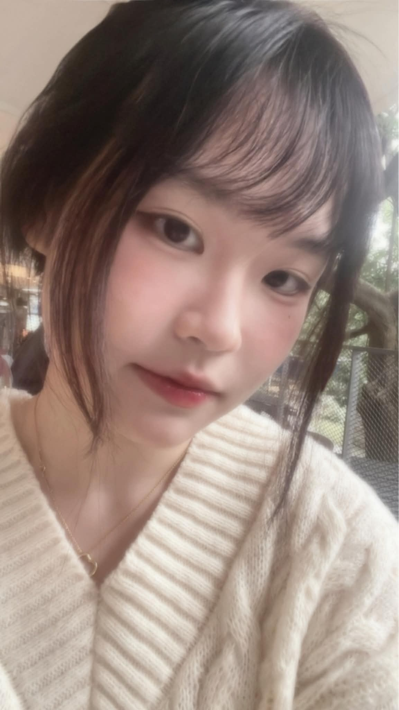

# Comfy UI 圖生圖
使用 ComfyUI 的 Image-to-Image（圖生圖）功能，將自己的照片轉換為其他風格
# 生成前
 
 # 生成後
 
 # 過程圖
 
 # 正面提示詞
 masterpiece, best quality, 2d anime illustration, thick clean outlines, anime girl portrait, bright eyes, vibrant colors, expressive illustration style
 # 負面提示詞
 worst quality, low quality, bad anatomy, bad hands, missing fingers, blurry
 # 心得
 本次實作 ComfyUI 圖生圖深具挑戰。主要卡在 SD v1.5 模型偏向寫實，且去噪強度（Denoising）極難掌控——數值太低風格沒變化，太高五官又容易崩壞。雖因卡頓與模型限制使最終效果有限，但讓我精準掌握了工作流連線與參數調校的實務經驗。
